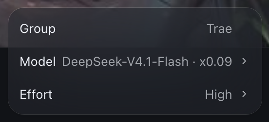

# dsh-model-group

给 [DeepSeek Harness](https://github.com/deepseek-ai) 的模型名补上它所属的**分组（provider）名称**。

输入框上方的触发按钮：


点开后的模型选择浮框（顶部多出一行，左侧标签、右侧分组名，与下面的 `Model` / `Effort` 同构）：



## 效果

- **触发按钮**：`Trae · DeepSeek-V4.1-Flash · x0.09` —— 模型名前面加上分组名
  （` · x0.09` 是模型名本身的一部分，原样保留）。
- **浮框根面板**：在 `Model` 行上方新增一行 `Group  Trae`，不可点击、不参与选中，
  几何与颜色跟真正的 `Model` / `Effort` 行对齐。
- **模型列表**：不加前缀 —— 那一栏每个分组上方本来就有分组标题，再重复一遍是噪音。

## 为什么需要插件

模型选择器把模型名当纯字符串渲染，**没有任何设置项能打开分组名**。唯一的入口是
`conversation.input.model.label` 这个单槽（single slot）：

- 槽的契约是「渲染非交互的内联内容（彩色名称、角标）」；点击、焦点、勾选、
  无障碍文案仍然归 picker 自己；
- 传给占位组件的 props 里带着 `provider: { id, name }`，`name` 就是设置里看到的
  分组显示名（`trae` → `Trae`、`trae-enterprise` → `Trae 企业版`、
  `deepseek-account` → `DeepSeek 账号`）；
- 官方文档给出的示例本身就是
  `({ provider, model }) => React.createElement('span', { title: provider.name }, model.name)`。

所以「在模型名前面显示分组名」= 注册这个槽，把 `provider.name` 画在 `model.name` 前面。

## 渲染位置

槽组件收到的 props 里带 `placement`，本插件按它分三种排版：

| `placement` | 位置 | 排版 |
| --- | --- | --- |
| `trigger` | 输入框上方的触发按钮 | 单行：`分组 · 模型` |
| `menu` | 浮框根面板 | 在 `Model` 行**上方**新增一行「左标签 + 右分组名」，`Model` 行保持纯模型名 |
| `option` | 浮框里展开的模型列表 | 不加前缀 |

`menu` 那行**没有槽可用**：宿主声明的输入区槽只有 `activity / attachments / dock /
left / model / model.label / overlay / permission / plan / right`，浮框内部结构由
`@deepseek-ai/dsh-client-ui-model-selection` 自己渲染。所以这一行是组件提交后自己去
DOM 里做的：

- 从 `menu` 位置的组件往上找最近的 `[role="menu"]` 容器；
- 在第一个 `button`（即 `Model` 行）之前 `insertBefore` 一个带
  `data-dsh-model-group-row` 的 `div`，里面是「左标签 + 右值」两个 `span`；
- 几何量照抄真正的 cell 行（实测）：`height 34px`、`padding 0 8px`、`gap 6px`、
  字号 `13px`、行高 `20px`；左侧标签左边缘与 `cellLabel` 左边缘重合
  （`x 1298.5`），右侧值的右边缘与 `cellValue` 右边缘重合
  （`right 1516.765625`，差值 0）—— 值是 `margin-left: auto` + `margin-right: 18px`
  推过去的，18px = cell 里值后面那段 `6px gap + 12px 箭头`；
- 颜色用主题 token：标签 `--dsw-alias-label-primary`、值 `--dsw-alias-label-tertiary`
  （实测 `rgb(161,164,170)`，与 `cellValue` 一致；`secondary` 是 `rgb(190,193,199)`，
  偏亮，用错就不齐）；
- 整行 `pointer-events: none`、`user-select: none`，不参与点击与选中。

左标签文案跟着界面语言走：`html[lang]` 以 `zh` 开头时用「分组」，否则用 `Group`
（宿主 UI 目前是英文，所以默认看到的是 `Group`）。

浮框容器是复用的（切进模型列表时同一个节点只是换了 `role` 和内容），手动插入的
节点不会随 React 卸载，所以 `useLayoutEffect` 的清理函数里会把它 `removeChild` ——
否则那行会滞留在模型列表顶部（列表里本来就有分组标题）。

## 覆盖关系

该槽是 single 槽，同一时刻只有一个占位者，且规则是「lowest renders」；同 priority
二次注册会**直接抛错**（`single slot "..." already has a registration at priority N`）。

实际占位者依次是：

- 宿主自带的 `@deepseek-ai/dsh-client-ui-deepseek-model-label-1017`（priority `0`）；
- `dsh-connect-workbuddy` 的 `WorkBuddyModelLabel`（priority `-0.5`），盖住上面那个；
- `dsh-connect-trae`（priority `0`）与 workbuddy 同槽但优先级更高，被盖住。

本插件显式注册在 `PRIORITY = -100`，低于以上全部，因此胜出。**必须显式写**：动态包
（`plugin_manager` 运行时加载）会被框架改写 priority，写了无副作用；但用
`dsh plugin add` 装进 `dsh.profile.bundles` 的静态 bundle 走普通 ctx，没人分配
priority → 默认 0，会与 `dsh-connect-trae` 撞车抛错、组件根本不渲染。代价是：

- workbuddy 的倍率角标、促销 badge、忙碌图标、新模型标记不再显示；
- trae 的 `PromoChip` 不再显示。

模型名里 ` · x0.09` 这段是写进 `name` 的，不是渲染出来的，所以会原样保留。

## 安装

本包没有依赖、没有构建步骤，用本地目录链接安装即可：

1. 打开「设置 → 插件」的安装输入框；
2. 粘贴本仓库的**绝对路径**（相对路径会被拒）：

   ```
   /Users/wangwei/Documents/github/dsh-model-group
   ```

3. 确认安装，等它出现在插件列表并处于启用状态。

安装走 `PluginManager.installBundle`：`pnpm add <path>` → 校验 `package.json` 的
`dsh.bundle.patch` → 选中 bundle → 发布并重载。纯 `insert` 的 patch 可以热挂载，
不需要重启应用。

也可以用命令行：

```bash
dsh plugin --profile desktop add /absolute/path/to/dsh-model-group
```

> 如果 UI 拒绝这个路径，说明该版本把输入框限定成了注册表包名；此时只能用
> `plugin_manager` 工具的 `install_bundle`（`target` 传上面的绝对路径），
> 或把它发布到 npm 后按包名安装。

## 文件

| 文件 | 作用 |
| --- | --- |
| `package.json` | 包清单；`dsh.bundle.patch` + `dsh.client`（`platform: web`、`inject` 会话包） |
| `cordis.patch.yml` | 往配置里插一行 `{ id, name }`；`name` 必须等于真实包名 |
| `index.js` | Host 半边，本插件无工具/路由，`apply()` 为空 |
| `client.js` | 客户端半边，注册 `conversation.input.model.label` 槽 |
| `locale/*.json` | 插件管理页显示的标题与描述 |
| `icon.svg` | 插件图标 |
| `docs/*.png` | README 用的效果截图 |

`client.js` 里的 factory id 必须与 `cordis.patch.yml` 的 `id` 一致，否则
ModuleLoader 会报 `loaded without registering <id>`。

## 验证

看输入框上方的模型名是否变成 `分组名 · 模型名`，以及点开浮框后 `Model` 行上方是否
多出一行 `Group  <分组名>`（左右两栏、与 `Model` / `Effort` 行对齐；点进模型列表后
那一行应消失）。没变化时依次排查：

1. 插件列表里是否已启用（未启用则没有注册任何槽）；
2. 控制台是否出现 `loaded without registering` 或槽注册冲突；
3. 换一个分组下的模型（例如从 Trae 切到 WorkBuddy），确认前缀跟着变。

## 已知限制

- 覆盖槽意味着同时被覆盖的插件不再显示自己的角标（见「覆盖关系」的代价一节）。
- 浮框那行是 DOM 注入，依赖 `@deepseek-ai/dsh-client-ui-model-selection` 的内部结构
  （`[role="menu"]` + `button` 行的排列）；该包改版后可能需要同步调整。
- 窄视口下触发按钮会被宿主折叠成只剩图标，此时看不到分组名 —— 这是宿主的响应式
  行为，不是插件的问题（实测 1440px 折叠，≥2000px 完整显示）。

## License

[MIT](LICENSE)
